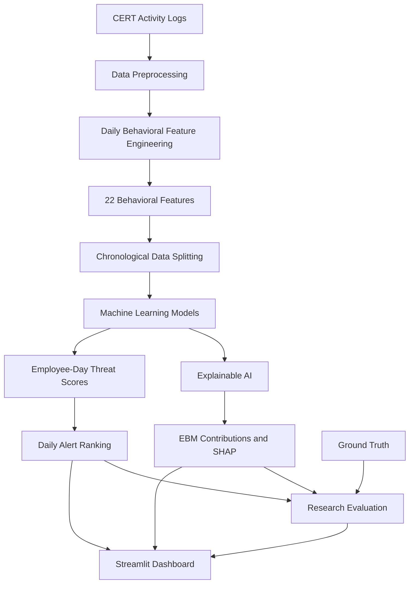

# Explainable Insider Threat Detection Using User Behavior Analytics

## Project Overview

An explainable machine learning framework for detecting and
prioritizing potentially malicious employee behavior using
User Behavior Analytics (UBA).

The system processes organizational activity logs, extracts
behavioral features, evaluates multiple machine learning models,
generates employee-day threat scores, and provides interpretable
explanations through an interactive Streamlit dashboard.

This project is an academic cybersecurity research prototype.

## Project Objectives

- Analyze employee behavioral patterns.
- Identify potentially malicious insider activities.
- Compare supervised and unsupervised detection models.
- Generate interpretable threat scores.
- Evaluate detection performance under limited analyst alert budgets.
- Assess explanation alignment, stability and generalization.
- Provide an interactive threat investigation dashboard.

## Dataset

CERT Insider Threat Test Dataset, Release r4.2.

Activity sources:

- Logon and logoff activity
- HTTP browsing activity
- Email activity
- USB device activity
- File operations

### Dataset Statistics

| Parameter | Value |
|---|---:|
| Raw activity events | 32,770,222 |
| Employee-day records | 330,452 |
| Behavioral features | 22 |
| Training records | 169,085 |
| Validation records | 40,097 |
| Testing records | 121,270 |
| Known malicious test records | 401 |
| Test employees | 918 |
| Known test insiders | 29 |
| Test positive prevalence | 0.331% |

Raw datasets and ground-truth answer files are maintained
separately and are not distributed with this repository.

## System Architecture



## Behavioral Features

### Authentication Features

- Total logon events
- Logon count
- Logoff count
- After-hours logons
- New PC count
- Unique PC count

### Web Activity Features

- HTTP requests
- After-hours HTTP requests
- Unique domains
- New domain count
- Cloud storage visits
- Job site visits

### Email Features

- Email count
- After-hours email activity
- External email count
- External attachment count

### USB Features

- USB events
- USB connection count
- USB disconnection count
- After-hours USB activity

### File Activity Features

- File operations
- After-hours file operations

## Machine Learning Models

Five machine learning models are evaluated:

1. Explainable Boosting Machine (EBM)
2. XGBoost
3. Random Forest
4. Pooled Isolation Forest
5. Per-user Isolation Forest

EBM is the primary detection model.

XGBoost is the comparative explainable model using TreeSHAP.

Isolation Forest models provide unsupervised detection baselines.

## Evaluation Methodology

All five controlled models use the same 22 behavioral features
and the same chronological evaluation records.

| Dataset Split | Period |
|---|---|
| Training | January-August 2010 |
| Validation | September-October 2010 |
| Testing | November 2010-May 2011 |

Hyperparameters are selected using validation average precision.
Selected models are refitted on the combined training and
validation data before test evaluation.

Evaluation metrics include:

- Average Precision (reported as PR-AUC)
- Precision at daily alert budgets
- Recall at daily alert budgets
- Distinct insiders detected
- Scenario-specific recall
- Confusion matrix
- False positive rate

Daily alert budgets of 10, 50 and 100 are evaluated.

## Controlled Model Comparison

Results at a budget of 10 alerts per day:

| Model | Average Precision | Precision | Recall | Insiders Detected |
|---|---:|---:|---:|---:|
| EBM | 0.8305 | 18.95% | 93.27% | 29/29 |
| XGBoost | 0.8247 | 18.74% | 92.27% | 28/29 |
| Random Forest | 0.5655 | 17.38% | 85.54% | 29/29 |
| Per-user Isolation Forest | 0.0116 | 1.52% | 7.48% | 14/29 |
| Pooled Isolation Forest | 0.0091 | 0.76% | 3.74% | 7/29 |

The random average precision baseline is approximately 0.0033.

EBM achieves the highest observed average precision and recall
at 10 alerts per day in the controlled comparison.

The small performance difference between EBM and XGBoost
has not been established as statistically significant.

## Explainable Artificial Intelligence

### Explainable Boosting Machine

- Intrinsically interpretable additive model
- 22 main feature terms
- 10 pairwise interaction terms
- Global feature importance
- Local employee-day explanations
- Prediction reconstruction verification

### XGBoost with SHAP

- TreeSHAP explanations
- Global feature importance
- Local feature contributions
- Waterfall plots
- True-positive and false-positive explanation analysis
- False-negative and true-negative explanation analysis

## Research Experiments

### Unseen-Employee Generalization

Five repeated employee holdout experiments evaluate performance
on employees excluded from model fitting.

| Metric | EBM | XGBoost |
|---|---:|---:|
| Mean Average Precision | 0.7293 | 0.7515 |
| Mean Recall@2/day | 86.19% | 84.02% |
| Mean Recall@10/day | 97.57% | 96.96% |

Each experiment evaluates 184 held-out employees.

### Explanation Alignment

Explanations are compared against known malicious activity
categories using an activity-to-feature mapping.

| Metric | EBM | XGBoost |
|---|---:|---:|
| Feature Alignment | 42.24% | 51.14% |
| Activity Coverage | 95.35% | 97.31% |
| Positive Attribution Alignment | 66.04% | 75.06% |
| Hit@5 | 99.25% | 99.25% |

These metrics measure activity-category alignment, not causal
explanation correctness.

### Explanation Stability

Top-five feature explanation stability under synthetic
activity-count perturbations:

| Perturbation | EBM | XGBoost |
|---|---:|---:|
| 5% | 89.88% | 91.38% |
| 10% | 86.63% | 87.86% |
| 20% | 84.33% | 84.94% |

Additional experiments include:

- Attack scenario analysis
- Isolation Forest training contamination analysis
- Explanation agreement comparison
- Model serialization verification
- Explanation computation performance
- Behavioral feature and temporal data audits

## Interactive Dashboard

The Streamlit dashboard contains eight pages:

1. Overview
2. User Behaviour Analytics
3. Threat Detection
4. Explainable AI
5. Ground Truth Validation
6. Global ML Evaluation
7. Attack Scenario Analysis
8. Model Reliability & Explainability

Dashboard functionality includes employee activity histories,
daily alert ranking, local model explanations, confusion matrices,
model comparison and research evaluation visualizations.

## Technology Stack

- Python
- Pandas
- NumPy
- Scikit-learn
- XGBoost
- InterpretML
- SHAP
- SciPy
- Joblib
- Streamlit
- Plotly
- Matplotlib

## Project Structure

```text
Insider_Threat_Shared/
|-- preprocessing/
|-- features/
|-- models/
|-- evaluation/
|-- backend/
|-- dashboard/
|-- tests/
|-- reports/
|   |-- research_results/
|-- config.py
|-- requirements.txt
|-- README.md
|-- .gitignore
```

The following local directories are excluded from version control:

- dataset/
- data/
- processed/
- outputs/
- saved_models/

Trained model files and employee-level prediction exports
are also excluded.

## Installation

The development environment uses Python 3.14.4 on Windows.

Clone the repository:

```bash
git clone https://github.com/P-alak-web/major-project.git
cd major-project
git checkout feature/advanced-uba-models
```

Create a virtual environment:

```powershell
py -3.14 -m venv .venv
```

Install dependencies:

```powershell
.\.venv\Scripts\python.exe -m pip install -r requirements.txt
```

Verify dependency compatibility:

```powershell
.\.venv\Scripts\python.exe -m pip check
```

## Reproducing the Experiments

Run the following stages from the repository root.

The original CERT r4.2 dataset and answer files must be
obtained separately.

Inspect the preprocessing and ground-truth scripts for their
required input paths and command-line arguments before execution.

### Stage 1: Data Preparation

Relevant scripts:

```text
preprocessing/preprocess.py
features/create_features.py
features/advanced_features.py
features/http_features.py
features/merge_advanced_features.py
evaluation/ground_truth.py
```

The controlled evaluation requires these generated files:

```text
processed/user_daily_features_advanced_v2.csv
outputs/ground_truth/ground_truth_user_day.csv
outputs/ground_truth/ground_truth_events.csv
```

### Stage 2: Controlled Model Evaluation

```powershell
python evaluation/prepare_controlled_data.py
python evaluation/check_common_eligibility.py
python evaluation/controlled_model_comparison.py
python evaluation/verify_controlled_models.py
```

### Stage 3: Explainability Evaluation

```powershell
python evaluation/explain_controlled_xgboost.py
python evaluation/explain_controlled_ebm.py
python evaluation/compare_explainability.py
python evaluation/evaluate_attack_scenarios.py
python evaluation/evaluate_explanation_alignment.py
python evaluation/evaluate_explanation_stability.py
```

### Stage 4: Generalization Evaluation

```powershell
python evaluation/evaluate_controlled_generalization.py
```

### Stage 5: Additional Contamination Experiment

```powershell
python evaluation/evaluate_if_contamination.py
```

### Stage 6: Launch Dashboard

After generating the required datasets, models, predictions
and evaluation results:

```powershell
python -m streamlit run dashboard/app.py
```

Use the virtual environment's Python interpreter for all
commands if the environment has not been activated.

The dashboard cannot run fully from a fresh clone until
the required local artifacts have been generated or restored.

## Research Results

Aggregate experimental results are preserved in:

```text
reports/research_results/
```

These include model comparisons, selected hyperparameters,
generalization results, scenario evaluation, explanation
alignment, explanation stability and feature importance.

These summaries can be inspected without retraining the models.

## Research Limitations

- CERT r4.2 is a synthetic dataset.
- The dataset is highly imbalanced.
- High recall is accompanied by substantial false alert burden.
- Model scores are not calibrated probabilities of malicious intent.
- Unlabelled employee-days are assumed normal for evaluation.
- Scenario-specific sample sizes are unequal.
- Explicit user-relative and peer-group baseline features are absent.
- Employee holdouts exclude employees from model fitting but
  do not constitute independent external validation.
- Explanation alignment depends on a manually defined mapping.
- Synthetic perturbations do not reproduce all real-world behavior changes.
- The historical test period has been examined during development.
- Fresh-environment end-to-end reproducibility remains to be verified.

## Team Contributions

Individual team responsibilities and contributions are maintained
by the project team.

## Disclaimer

This system is an academic research prototype intended for
security analyst decision support.

An anomaly or high model score is not proof of malicious intent.

The system is not intended to make automated disciplinary
decisions or replace human security investigation.